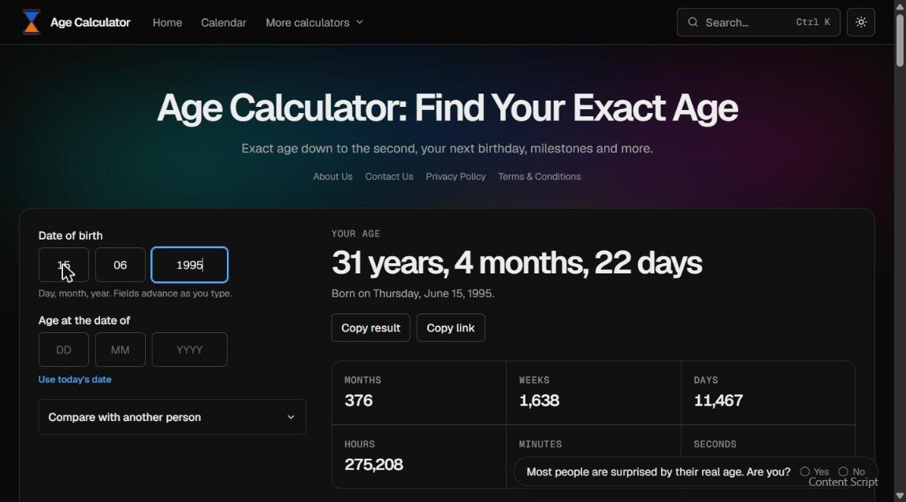
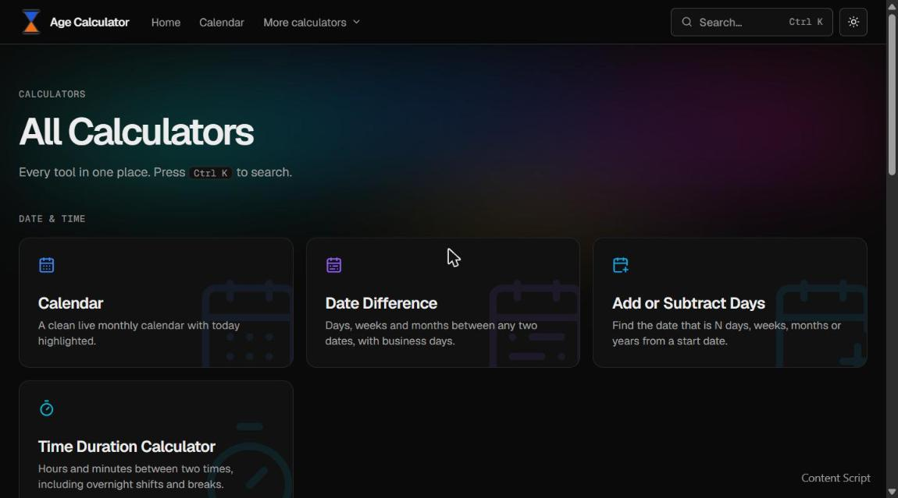
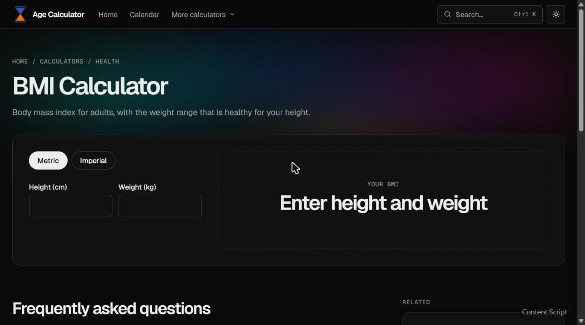
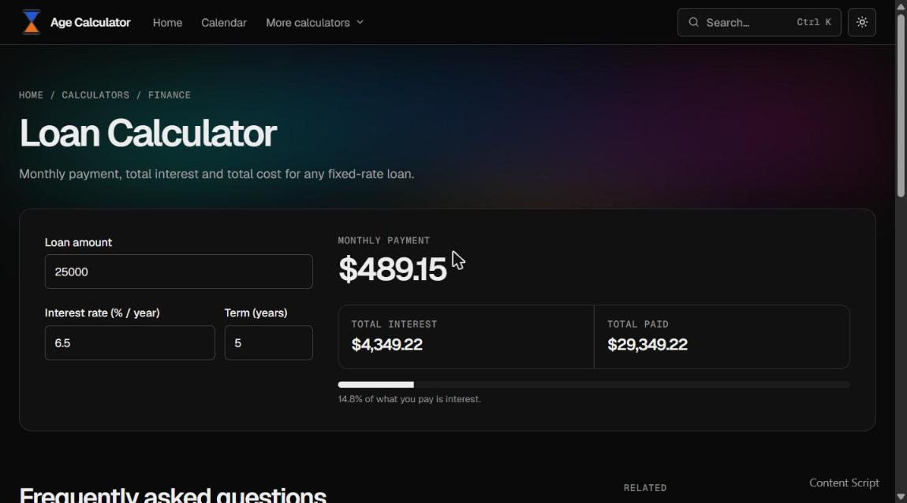

# AgeCalculates

A free collection of fast, simple online calculators, led by an age calculator.

Live site: https://www.agecalculates.com

## Screenshots

### Age calculator



### All calculators



### BMI calculator



### Loan calculator



## Calculators

Age, date, add/subtract days, time, due date, BMI, loan, compound interest, GPA, percentage, tip, unit converter, and calendar.

## Tech stack

Astro, with static pages in src/pages and shared components, layouts and styles in src.

## Getting started

```
npm install
npm run dev (local server at localhost:4321)
npm run build (production build to ./dist/)
npm run preview (preview the build)
```

## Project structure

src/pages holds one page per calculator. src/components, src/layouts, src/lib, src/data and src/styles hold the shared code. public holds static assets.

## About

Built by Aditya Kaundal as a personal project, with help from Claude.
